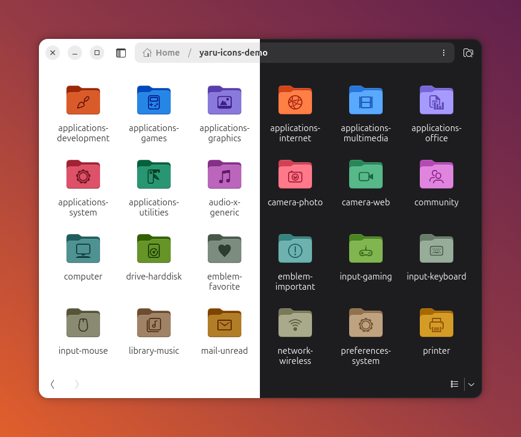

# yaru-folder-icons

Custom folder icons for Ubuntu's **Yaru** theme: Yaru's own folder with a symbol on it, drawn in
Yaru's embossed style, for every Yaru colour variant (light/dark, all accents, MATE).

A small Python script composes any `*-symbolic.svg` (for example the ~1300 in
`/usr/share/icons/Yaru/scalable`) onto the folder icon of any Yaru variant, as a **PNG** or as a
**scalable SVG**, and can set the result on a folder in Nautilus (Files). SVG output needs no
installed Yaru theme: the data of all 26 variants ships with the script.



Run `./yaru-folder-icon.py` without arguments (or with `--help`) for the full description of
every command and option.

## Quick start

```bash
sudo apt install python3-pil python3-numpy python3-scipy librsvg2-bin
git clone https://github.com/VladyslavChernyshov/yaru-folder-icons && cd yaru-folder-icons

# put a "community" symbol on ~/Music using your current icon theme
./yaru-folder-icon.py apply ~/Music community

# see all available symbol names
ls /usr/share/icons/Yaru/scalable/*/ | grep -- -symbolic | sed 's/-symbolic.svg//' | less

# undo
./yaru-folder-icon.py reset ~/Music
```

`apply` detects the active icon theme (`gsettings get org.gnome.desktop.interface icon-theme`),
looks its colours up in the built-in table (`assets/themes.json`), builds a scalable SVG in `~/.local/share/folder-icons/` and runs
`gio set <folder> metadata::custom-icon file://<png>`.
Options: `--theme Yaru-purple-dark`, `--format png` (then `--size 256`), `--scale 1.2`,
`--align bbox|mass|yaru`, `--keep-opacity`, `--dry-run`.

## Commands

| Command | What it does |
|---|---|
| `apply FOLDER SYMBOL` | build an icon for one folder and set it in Nautilus |
| `reset FOLDER` | remove the custom icon again |
| `batch --out DIR` | generate icons for many symbols, themes and sizes at once |
| `THEME_DIR SYMBOL.svg OUT.png` or `OUT.svg` | write one icon file, touch nothing else |

```bash
# one scalable SVG (the extension of the output file decides the format);
# the theme is a built-in variant name, or the path of an installed theme
./yaru-folder-icon.py Yaru-dark /usr/share/icons/Yaru/scalable/actions/share-symbolic.svg share.svg
./yaru-folder-icon.py /usr/share/icons/Yaru-dark /usr/share/icons/Yaru/scalable/actions/share-symbolic.svg share.svg

# a Nautilus icon straight from the SVG
gio set ~/Music metadata::custom-icon file://$PWD/share.svg
```

## How it looks like Yaru

Yaru draws folder symbols as an inset-shadow emboss: a dark symbol, a darker top edge, and a
light highlight below it. The script reproduces this from measurements of Yaru's own
`folder-publicshare` icon. Colours are **not hard-coded**: they are calibrated at run time by
comparing `folder.png` with `folder-publicshare.png` of the selected theme, so every accent and
dark variant (and future ones) work automatically.

* The symbol is centred on the folder's front panel (`--align bbox`: by bounding box, default;
  `mass`: by centre of mass; `yaru`: Yaru's own fixed position).
* Symbols are normalised: odd `viewBox` sizes are handled, oversized symbols are shrunk to fit
  the panel, and anything a symbol draws outside its own `viewBox` is cut off (some Yaru symbols
  carry stray glyphs there).
* Below 256 px the symbol is flat, as in Yaru; Yaru's two 16 px folders have no symbol at all.

## Scalable SVG icons

An SVG icon is one self-contained file (about 12 KiB, no external references): Yaru's folder
drawing for the chosen variant, with the symbol embossed by SVG masks. It renders the same as
the PNG (checked automatically against the raster output) at any size.

* The folder drawing comes from Yaru's `folders.svg` source sheet and is stored in `assets/`
  (`folder-template.svg` for all variants, `folder-template-mate.svg` for light `Yaru-mate`,
  which Yaru draws separately). The two accent colours of the template are fitted per theme by
  comparing a render with that theme's `folder.png`.
* The result of that measurement for every Yaru variant (template colours, emboss colours,
  front-panel centre; about 4 KiB) is stored in `assets/themes.json`. That is why SVG output works
  without any Yaru theme installed. Pointing at a theme directory (a path, or `--icons-root`)
  measures that theme instead, which is how you handle a variant that is not in the table yet.
* `tools/build_themes_json.py --icons-root DIR` rebuilds the table, `tools/extract_template.py`
  cuts a template out of Yaru's `folders.svg`.
* Nautilus accepts these SVGs as custom folder icons.

## Pre-generated icons

Releases contain ready-made sets, one archive per theme variant (SVG: about 4 MB per variant for
all ~1300 symbols), and the 512 px PNG sets:

```
<theme>/scalable/<symbol>.svg
<theme>/512/<symbol>.png                 (512 px; a size directory such as 48x48@2x for --sizes 48x48@2x)
```

Generate them yourself:

```bash
# every symbol x every installed Yaru theme, SVG plus 512 px PNG
./yaru-folder-icon.py batch --out dist --themes all --sizes svg,512

# only some themes / symbols; all PNG sizes Yaru ships (24 px and up)
./yaru-folder-icon.py batch --out dist --themes Yaru,Yaru-dark --only '^(share|folder)' --sizes svg,all

# PNG output, or measuring from Yaru's source tree instead of the built-in table
./yaru-folder-icon.py batch --icons-root ~/yaru/src/icons --out dist
```

`--sizes` takes `svg`, `512`, `256`, Yaru size directories (`24x24`, `48x48@2x`, ...) or `all`
(all PNG sizes except the two 16 px ones). All 26 themes with ~1300 symbols as SVG (34 398 files) take about
a minute on a desktop PC.

## Limitations

* Nautilus accepts **one file per folder** in `metadata::custom-icon`, so an icon is tied to one
  theme variant: if you switch between light and dark, or change the accent colour, re-run
  `apply` (or use a variant that fits both).
* `apply` makes an SVG by default; `--format png` makes a 512 px PNG (Nautilus scales it down).
* The icon is stored per folder in GVfs metadata (not in the folder), so it is local to your
  user account and is lost when the folder is moved to another machine.
* PNG output and SVGs for variants that are not in `assets/themes.json` need the theme as PNG
  folders (`<theme>/256x256@2x/places/folder.png`, `folder-publicshare.png` and
  `<theme>/256x256/places/folder.png`): the colours are measured from them. Variants like
  `Yaru-mate` come from separate packages.
* When Yaru adds or recolours a variant, rebuild the table (`tools/build_themes_json.py`); the test
  `test_themes_json_is_complete_and_up_to_date` tells you.

## Options worth knowing

* **Opacity**: by default every part of a symbol is drawn fully opaque, so symbols that Yaru draws
  with translucent "secondary" parts look uniform. `--keep-opacity` renders them as in the
  original SVG.
* **`overrides.json`**: per-symbol `scale`, `dx`, `dy`, `align` for exceptions (for example very
  wide symbols that would otherwise look small). The file sits next to the script and applies to
  PNG and SVG alike. Try a change on one folder first:
  `./yaru-folder-icon.py apply DIR name --scale 1.3 --dry-run`.

## Licence

* **Script** (`yaru-folder-icon.py`, tools, tests): MIT, see `LICENSE`.
* **Folder templates in `assets/`** and **generated icons**: derivatives of Yaru's artwork, so
  they are licensed **CC BY-SA 4.0**; see `NOTICE.md` for attribution.

## Development and tests

```bash
sudo apt install python3-pytest
python3 -m pytest -v                          # uses the Yaru themes installed in /usr/share/icons
YARU_ICONS_ROOT=~/yaru/src/icons YARU_SYMBOLS_DIR=~/yaru/src/icons/Yaru/scalable python3 -m pytest
python3 tools/check_centering.py dist/Yaru-dark/512    # centring report for a generated set
python3 tools/contact_sheet.py dist/Yaru-dark/512 sheet.png --every 8   # look at it
python3 tools/extract_template.py yaru/src/fullcolor/accented-full/places/folders.svg assets/folder-template.svg
python3 tools/build_themes_json.py --icons-root ~/yaru/src/icons    # refresh assets/themes.json
python3 tools/make_screenshot.py                                    # redraw docs/screenshot.png (fake Nautilus, light | dark)
```

For every Yaru variant that is found, the tests check that colour calibration is sane, that only
the symbol changes (the folder silhouette stays untouched), that the symbol is centred on the
front panel, that oversized and odd-canvas symbols are fitted, that overrides are valid, that
the SVG output matches the PNG output and cuts off content outside the `viewBox`, that
the built-in table in `assets/themes.json` is complete, matches the installed themes and gives the
same SVG as measuring the theme, `batch` works and `--help` documents every option. GitHub Actions runs the same tests on
every push (`.github/workflows/test.yml`) and publishes contact sheets as a build artifact.
